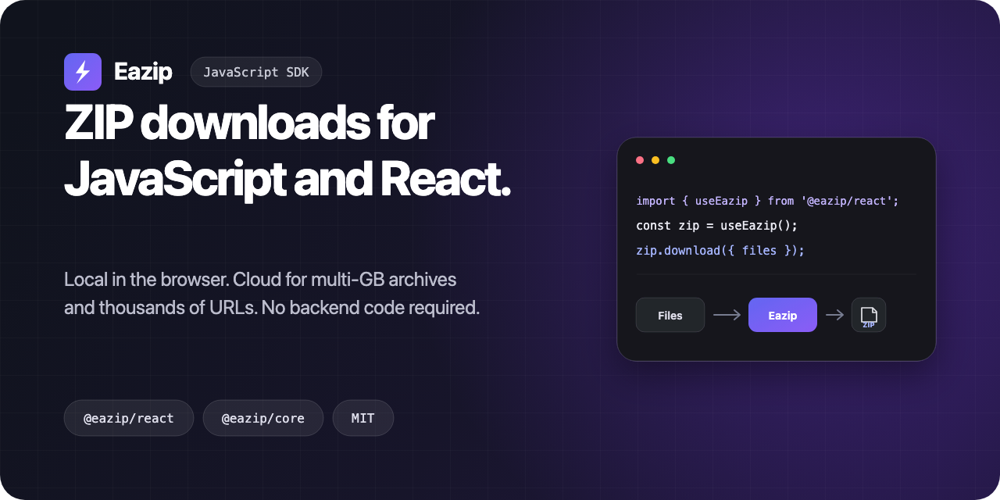

# Eazip JavaScript SDK



[](https://github.com/Eazip/eazip-js/actions/workflows/ci.yml)
[](https://www.npmjs.com/package/@eazip/react)
[](https://www.npmjs.com/package/@eazip/core)
[](LICENSE)

Create ZIP downloads in JavaScript or React. Start entirely in the browser;
switch to Eazip Cloud for multi-GB archives and thousands of URLs — without any
backend code.

- **Browser first:** zip `File`, `Blob`, and URL sources locally. Nothing is
  uploaded and no Eazip account is needed.
- **React ready:** `useEazip()` and `<EazipTray />` add progress, cancellation,
  retry, partial-result handling, and download UI.
- **Cloud when needed:** keep the same frontend flow when a job is too large for
  a browser tab.

**[Read the docs](https://eazip.io/docs?utm_source=eazip_js&utm_medium=github_readme&utm_campaign=oss_acquisition&utm_content=root_docs)** ·
**[Try React in StackBlitz](https://stackblitz.com/github/Eazip/eazip-js?startScript=dev%3Areact-example)** ·
**[Try JavaScript in StackBlitz](https://stackblitz.com/github/Eazip/eazip-js?startScript=dev%3Aclient-example)**

## Choose your package

| Package | Best for | Install |
| --- | --- | --- |
| [`@eazip/react`](packages/react) | React apps that want a hook and ready-made download tray | `npm install @eazip/react` |
| [`@eazip/core`](packages/core) | Any JavaScript app, or a fully custom interface | `npm install @eazip/core` |

`@eazip/react` uses `@eazip/core` internally, so React apps only need to install
the React package.

## React quickstart

```tsx
import { EazipTray, useEazip } from '@eazip/react';

export default function App() {
  const zip = useEazip();

  return (
    <>
      <input
        type="file"
        multiple
        onChange={(event) => {
          const files = event.currentTarget.files;
          if (files?.length) {
            zip.download({ files, zipName: 'documents.zip' });
          }
        }}
      />
      <EazipTray />
    </>
  );
}
```

No provider or CSS import is required. The tray appears when a job starts and
handles progress, completion, partial results, failures, and retries.

[Open this React example in StackBlitz →](https://stackblitz.com/github/Eazip/eazip-js?startScript=dev%3Areact-example)

[React guide](https://eazip.io/docs/getting-started/react?utm_source=eazip_js&utm_medium=github_readme&utm_campaign=oss_acquisition&utm_content=root_react_docs) ·
[`@eazip/react` API](packages/react/README.md)

## JavaScript quickstart

```ts
import { createZip } from '@eazip/core';

const input = document.querySelector<HTMLInputElement>('#files');

input?.addEventListener('change', async () => {
  if (!input.files?.length) return;

  const result = await createZip({
    files: input.files,
    zipName: 'documents.zip',
  });

  result.download();
});
```

```html
<input id="files" type="file" multiple />
```

The local strategy supports `File[]`, `FileList`, `Blob`s, URL strings, and
`{ url | file, filename }` objects. Failed URL sources are skipped and reported
instead of failing the whole ZIP. Remote URLs must allow browser CORS.

[Open this JavaScript example in StackBlitz →](https://stackblitz.com/github/Eazip/eazip-js?startScript=dev%3Aclient-example)

[JavaScript guide](https://eazip.io/docs/getting-started/javascript?utm_source=eazip_js&utm_medium=github_readme&utm_campaign=oss_acquisition&utm_content=root_javascript_docs) ·
[`@eazip/core` API](packages/core/README.md)

## Local or Cloud?

| | Local | Eazip Cloud |
| --- | --- | --- |
| Runs | In the browser | On managed infrastructure |
| Setup | No account or key | Publishable `pk_ez_...` key |
| Best for | Everyday browser downloads | Multi-GB archives and thousands of URLs |
| Survives page reloads | No | Yes |
| Backend code required | No | No |

Switch a large job to Cloud by adding a strategy and public key:

```ts
import { startZip } from '@eazip/core';

const job = startZip({
  strategy: 'cloud',
  publicKey: 'pk_ez_...',
  files: urls,
  zipName: 'export.zip',
});

const result = await job.done;
result.download();
```

Cloud jobs can be resumed, split into multiple ZIPs, and downloaded from signed
URLs. If the source list must stay private, your backend can create the session
while the SDK continues to own progress and downloads.

[Cloud guide](https://eazip.io/docs/cloud?utm_source=eazip_js&utm_medium=github_readme&utm_campaign=cloud_activation&utm_content=root_cloud_docs) ·
[Get a public key](https://eazip.io/docs/cloud/get-a-public-key?utm_source=eazip_js&utm_medium=github_readme&utm_campaign=cloud_activation&utm_content=root_public_key) ·
[Backend-created sessions](https://eazip.io/docs/cloud/backend-sessions?utm_source=eazip_js&utm_medium=github_readme&utm_campaign=cloud_activation&utm_content=root_backend_sessions)

## Run the examples locally

```sh
npm install
npm run dev:react-example
# or
npm run dev:client-example
```

Local mode works immediately. To test Cloud mode, copy the example's
`.env.example` to `.env`, set `VITE_EAZIP_PUBLIC_KEY`, and allow the local origin
in your Eazip Public App.

## Repository scope

This repository contains Eazip's public browser SDKs, documentation site, and
examples. Server APIs, dashboard code, infrastructure, and internal services
live elsewhere.

## Contributing

Start with [ARCHITECTURE.md](ARCHITECTURE.md) for the package map and invariants.
Then run:

```sh
npm install
npm run build
npm run typecheck
npm run test
```

Questions and ideas belong in
[GitHub Discussions](https://github.com/Eazip/eazip-js/discussions). Use an
[issue](https://github.com/Eazip/eazip-js/issues/new/choose) for reproducible bugs
or concrete feature requests. Please report vulnerabilities through the
[security policy](SECURITY.md), not a public issue.

## Status

The SDK is available on npm's stable channel. Versions remain pre-`1.0.0`, so
breaking changes will be called out in the changelog and released with an
appropriate `0.x` version bump. `@eazip/core` supersedes the earlier
`@eazip/client` beta.

## License

[MIT](LICENSE)
